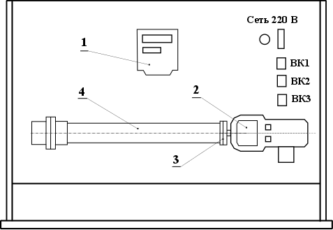

# ЛР № 2. Исследование средств звукоизоляции

Конспект к началу лабы (переписать от руки). Методичка — [задание.docx](задание.docx).

**Цель:** изучить воздействие шума на организм человека и способы защиты от шума;
экспериментально определить параметры шума; исследовать влияние звукоизолирующих
материалов на величину звукового давления.

**Задачи:**
1. Изучить воздействие шума на организм человека.
2. Ознакомиться с аппаратурой для измерения уровня и спектра шума.
3. Экспериментально определить параметры шума.
4. Определить влияние звукоизолирующих материалов на снижение уровня шума
   в зависимости от частоты, уровня звукового давления и типа сигнала.

**Приборы:** стенд «Шум», шумомер UT-352, ПК с Measlab Explorer.

## Основные характеристики шума

**Шум** — совокупность звуков различной частоты и интенсивности. Слышимый диапазон
16 Гц – 20 кГц; ниже — инфразвук, 20–1000 кГц — ультразвук.
По происхождению: механический, аэрогидродинамический, электромагнитный.

Характеристики: звуковое давление p (Па), интенсивность I (Вт/м²), частота f (Гц).

| Что | Формула |
| --- | --- |
| Интенсивность | I = p² / (ρ·c), c = 343 м/с |
| Уровень звукового давления | L_p = 20·lg(p / p₀), p₀ = 2·10⁻⁵ Па |
| Уровень интенсивности | L_I = 10·lg(I / I₀), I₀ = 10⁻¹² Вт/м² |
| Уровень звука (дБА) | L_A = L − ΔL_A |
| Требуемое ослабление | ΔL_тр = L − L_доп |
| Ослабление однослойной стенкой | ΔL = 20·lg(M·f) − 47,5 (M — кг/м²) |

Порог слышимости — 0 дБ, болевой порог — 140 дБ (p = 200 Па). Ухо чувствительнее всего
на 800–4000 Гц.

Звукоизоляция — **отражает** звук (коэф. звукопроницаемости τ = P_пр / P_пад), нужны
плотные массивные материалы. Звукопоглощение — **поглощает** в порах
(КЗП α = P_погл / P_пад; кирпич 0,01–0,05, поглотители > 0,2).

## Классификация методов защиты от шума

1. Уменьшение шума в источнике (−20…25 дБ): безударные механизмы, косозубые шестерни, смазка.
2. Уменьшение на пути распространения: экраны, перегородки, кожухи, звукоизоляция и звукопоглощение.
3. Рациональная планировка, зелёные насаждения.
4. СИЗ (беруши, наушники).

Норма для помещений программистов: **50 дБА** (лаборатории — 80 дБА, производство — 85 дБА).

## Схема стенда

1 — генератор звуковых сигналов; 2 — шумомер; 3 — место установки перегородок;
4 — акустическая труба с излучателем.

## Таблица 3. Результаты (тип сигнала ____, амплитуда ____)

| | 400 | 500 | 1000 | 2000 | 4000 | 8000 Гц |
| --- | --- | --- | --- | --- | --- | --- |
| L_ф, дБ | | | | | | |
| L₁ / L₂ / L₃, дБ | | | | | | |
| L_ср, дБ | | | | | | |
| p, Па | | | | | | |
| L_ЗИср (перегородка ____), дБ | | | | | | |
| p, Па | | | | | | |
| Э | | | | | | |

L_ср = (L₁ + L₂ + L₃) / 3;  Э = (L_ср − L_ЗИср) / L_ср;  p = p₀ · 10^(L_ср/20).
Перегородки: пенопласт высокого давления, пенопласт низкого давления, гофрокартон.
График: Э(f) для каждой перегородки.

**Выводы:** _(вписать: на каких частотах перегородка эффективнее, какой материал лучше,
превышены ли L_доп по табл. 2)._
