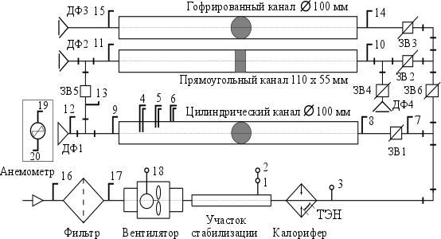

# ЛР № 3. Вентиляция

Конспект к началу лабы (переписать от руки). Методичка — [задание.docx](задание.docx).

**Цель:** определение производительности вентиляционной установки и измерение уровня её шума.

**Задачи:**
1. Изучить виды и возможности вентиляции.
2. Ознакомиться с методами расчёта воздухообмена.
3. Ознакомиться с методами измерения давления и скорости потока газа.
4. Экспериментально определить скорость воздуха в вентиляционной системе.
5. Рассчитать потребный воздухообмен.

**Приборы:** стенд «Вентиляционные системы», ПК с Measlab Explorer, шумомер UT-352.

## Краткие теоретические сведения

**Вентиляция** — совокупность устройств и мероприятий, обеспечивающих регулируемый
воздухообмен в помещении. Задачи: санитарно-гигиенические и технические.

| Признак | Виды |
| --- | --- |
| Способ побуждения | естественная (инфильтрация, проветривание, аэрация), механическая |
| Направление | приточная, вытяжная, приточно-вытяжная (можно с рециркуляцией) |
| Охват | общеобменная, местная (души, оазисы, завесы; зонты, отсосы, шкафы) |

**Расчёт воздухообмена L, м³/ч:**
- по людям: L = L_ч · N (V_ч < 20 м³ → L_ч ≥ 30 м³/ч; > 20 м³ → ≥ 20 м³/ч);
- по вредным веществам: L = q_вр / (z₁ − z₂);
- по влаге: L = m · q_вл / (d_у − d_п);
- **по теплоизбыткам (1):** L_пр = Q_изб / (c · ρ · (t_уд − t_пр)), c = 1 кДж/(кг·°С), ρ = 1,2 кг/м³;
- по кратности: L = K · V.

Теплоизбытки: Q_изб = Q_л + Q_р; солнце (2): Q_р = F_о · q_о · A_о (A_о = 0,73).
Перенос тепла: теплопроводность, конвекция, излучение.

**Производительность (3):** L = 3600 · F · υ. Для трубы Ø 100 мм F = 0,00785 м² → L ≈ 28,3 · υ.

**Законы движения воздуха:** постоянство потока F₁·υ₁ = F₂·υ₂;
Бернулли ρυ²/2 + ρgh + P = const → P_полн = P_дин + P_ст.
P_дин меряют трубкой Пито–Прандтля + дифманометром.

Скорость: υ_расч = 1,24 · √P_дин,  P_дин.ср = ((√P₁ + √P₂ + √P₃) / 3)².

Шум: L_p = 20·lg(P / P₀), P₀ = 2·10⁻⁵ Па. Норма: программисты 50 дБА, лаборатории 80 дБА.

## Схема стенда

Схема исследуемой вентиляции: ДФ1 открыт, ЗВ1 открыта, остальные заслонки закрыты →
вентилятор → цилиндрический канал (точки 4, 5, 6) → ДФ1.

## Таблица 1. Результаты экспериментов

| Мощность | P_дин1 | P_дин2 | P_дин3 | P_дин.ср, Па | υ_расч, м/с | υ_факт | Шум факт / доп, дБА |
| --- | --- | --- | --- | --- | --- | --- | --- |
| 20 % | | | | | | | |
| 60 % | | | | | | | |
| 100 % | | | | | | | |

## Таблица 2. Расчёт воздухообмена

| Q_л, Вт | Q_р, Вт | Q_изб, Вт | L_пр, м³/ч | Мощность | L_расч (υ_расч) | L_эксп (υ_факт) |
| --- | --- | --- | --- | --- | --- | --- |
| | | | | 20 % | | |
| | | | | 60 % | | |
| | | | | 100 % | | |

Q_л — работа средней тяжести: 205 Вт/чел при 20 °С (табл. П1); женщины × 0,85.
1 Вт = 3,6 кДж/ч.

**Выводы:** _(вписать: на какой мощности L_эксп ≥ L_пр, укладывается ли шум в норму,
нужна ли модернизация)._
