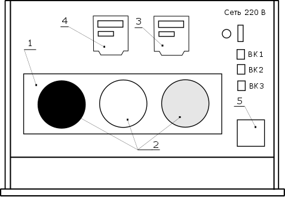

# ЛР № 5. Исследование средств защиты от тепловых излучений

Конспект к началу лабы (переписать от руки). Методичка — [задание.docx](задание.docx).

**Цель:** изучить влияние тепловых излучений на организм человека и способы защиты от них,
экспериментально определить параметры излучения и оценить эффективность средств защиты.

**Задачи:**
1. Изучить воздействие ИК-излучения на организм человека.
2. Ознакомиться с основными способами и методами защиты от тепловых излучений.
3. Экспериментально определить параметры ИК-излучения.
4. Экспериментально определить эффективность защитных экранов.

**Приборы:** стенд «Тепловые излучения», ПК с Measlab Explorer, пирометр DT-8835,
измеритель плотности теплового потока ИПП-2М.

## Основные характеристики ИК-излучения

**ИК-излучение** — электромагнитное излучение с λ ≈ 0,74 мкм … 1 мм, невидимое глазу.
Излучает любое тело с T > 0 К.

| Область | λ, мкм | Действие на человека |
| --- | --- | --- |
| ИК-А (коротковолн.) | 0,74–1,4 | проникает на несколько см, в мозг → солнечный удар |
| ИК-В (средневолн.) | 1,4–3,0 | задерживается в коже (0,1–0,2 мм), нагрев кожи и организма |
| ИК-С (длинноволн.) | > 3,0 | сильнее всего греет кожу → тепловой удар; 5–15 мкм — полезны |

**Формулы:**

- Закон Вина (1): λ_max = C / T, C = 0,002898 м·К (×10⁶ → мкм)
- при R ≥ √S (2): E = 0,91 · S · [(0,01·T)⁴ − 85] / R²
- при R < √S (3): E = 0,91 · S · [(0,01·T)⁴ − 85] / R

E — плотность потока, Вт/м²; S — площадь излучателя, м²; T — температура излучателя, К;
R — расстояние, м.

**Нормы (ГОСТ 12.1.005-88)** от нагретых поверхностей: ≤ 35 Вт/м² (облучение > 50 % тела),
≤ 70 Вт/м² (25–50 %), ≤ 100 Вт/м² (≤ 25 %); открытые источники — ≤ 140 Вт/м² + СИЗ.
Поверхности оборудования ≤ 45 °С.

## Классификация методов защиты

1. Устранение источника (снижение T или мощности).
2. Защита временем (до 350 Вт/м² — без ограничений, 500 — 20 мин, 1200 — 10 мин).
3. Защита расстоянием.
4. Экранирование, теплоизоляция, охлаждение поверхностей.
5. Увеличение теплоотдачи человека — воздушное душирование (υ ≤ 5 м/с).
6. СИЗ: светлая х/б или шерстяная спецодежда, ткань с металлизацией (отражает до 90 %),
   очки со светофильтрами (жёлто-зелёные, синие).

| Экраны по принципу | Примеры |
| --- | --- |
| теплоотражающие | альфоль, алюминий, оцинкованная сталь |
| теплопоглощающие | кирпич, асбест, шлаковата |
| теплоотводящие | водяные завесы |

По прозрачности: непрозрачные, прозрачные (стекло, водяная плёнка), полупрозрачные (сетки, цепные завесы).

## Схема стенда

1 — блок мишеней; 2 — мишени (Э1 чёрная, Э2 белая, Э3 полированный металл);
3 — счётчик электроэнергии; 4 — измеритель температур; 5 — контроллер TC4S.

## Таблица 1. Результаты экспериментов (T мишеней = 70 °С)

| R, см | E Э1, Вт/м² | E Э2 | E Э3 | T_и Э1, °С | T_и Э2 | T_и Э3 |
| --- | --- | --- | --- | --- | --- | --- |
| 5 | | | | | | |
| 10 | | | | | | |
| 15 | | | | | | |
| 20 | | | | | | |
| 25 | | | | | | |

S мишени = ____ м². График: E(R) для Э1, Э2, Э3 на одних осях.

Расчёт для Э1: E(5 см) = ____ Вт/м², E(15 см) = ____ Вт/м² — сравнить с измеренными.
λ_max = 0,002898 / ____ К = ____ мкм → диапазон ____.

**Выводы:** _(вписать: как E падает с расстоянием, какая мишень излучает сильнее,
совпадает ли расчёт с опытом, в какой диапазон попала λ и чем он опасен)._
