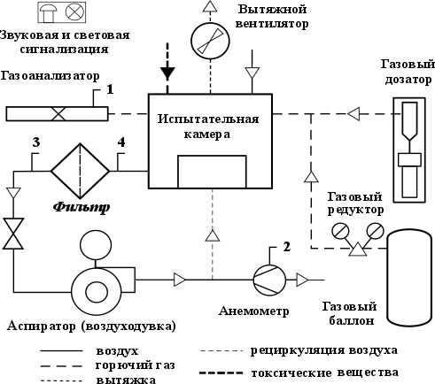

# ЛР № 8. Оценка состояния воздушной среды

Конспект к началу лабы (переписать от руки). Методичка — [задание.docx](задание.docx).
Лаба из двух частей: часть 1 — вредные газы, часть 2 — пыль.

## Общие сведения

**Вредные вещества** — вещества, которые при контакте с организмом вызывают ухудшение
самочувствия, профзаболевания или отклонения здоровья сейчас или в отдалённые сроки.

**ПДК_рз** — концентрация, которая при 8-часовом дне (≤ 41 ч/нед) за весь стаж не вызывает
заболеваний у работника и потомков. ПДК для населённых пунктов жёстче (на всю жизнь).

| Класс | Опасность | ПДК_рз, мг/м³ | Примеры |
| --- | --- | --- | --- |
| 1 | чрезвычайно опасные | < 0,1 | свинец, ртуть |
| 2 | высокоопасные | 0,1–1,0 | бензол, оксиды азота |
| 3 | умеренно опасные | 1,1–10 | ацетон |
| 4 | малоопасные | > 10 | аммиак, угарный газ |

По действию: общетоксические, раздражающие, сенсибилизирующие, мутагенные, канцерогенные,
влияющие на репродукцию. Однонаправленные вещества: C₁/ПДК₁ + C₂/ПДК₂ + … + C_n/ПДК_n ≤ 1.

Пробы — в рабочей зоне (до 2 м), в 0,5 м от источника. Контроль: 1 класс — раз в 10 дней,
2 — раз в месяц, 3–4 — раз в квартал.

## Схема стенда

1 — датчик концентрации C; 2 — датчик расхода Q; 3, 4 — датчики разности давления ΔP.

---

## Часть 1. Определение содержания вредных веществ в воздухе

**Цель:** ознакомиться со свойствами вредных веществ, их влиянием на организм человека;
изучить методики исследования загазованности воздуха.

**Задачи:** 1) ознакомиться с требованиями к воздуху рабочей зоны; 2) ознакомиться
с методами измерения концентрации вредных веществ; 3) определить концентрацию газа
и сравнить с ПДК.

**Приведение к стандартным условиям (1)** (20 °С, 101,3 кПа, φ = 60 %):
C_ст = C_факт · (273 + t) · 101,3 / (293 · K_в · p),  K_в = 1, p в кПа.

| Время, мин | 1 | 2 | 3 | 4 | 5 | 6 |
| --- | --- | --- | --- | --- | --- | --- |
| C_факт, мг/м³ (подача газа) | | | | | | |
| C_факт после ВК1 (вытяжка) | | | | | | |
| C_ст, мг/м³ | | | | | | |

Газ ______, ПДК_рз = ____ мг/м³ (табл. П2: CO 20, аммиак 20, ацетон 200, этанол 1000).

---

## Часть 2. Исследование запылённости воздуха

**Цель:** ознакомиться со свойствами пыли, её влиянием на организм человека;
изучить методики исследования запылённости воздуха.

**Задачи:** 1) изучить виды аэродисперсных систем; 2) ознакомиться с воздействием пыли
на организм; 3) ознакомиться с методами измерения концентрации пыли; 4) определить
концентрацию и размеры пылинок; 5) охарактеризовать дисперсный состав, средний размер
и форму частиц цифровым микроскопом.

**Аэрозоли:** пыль — твёрдые 1–75 мкм, дым — < 1 мкм, зола — > 75 мкм, туман — жидкие < 10 мкм.
По дисперсности: крупная > 10 мкм, средняя 5–10, мелкая < 5 мкм.
Действие: фиброгенное, раздражающее, токсическое, аллергическое, радиационное, канцерогенное.
Методы: весовой (мг/м³), счётный (пылинок/см³), фотометрический.

**Расчёт (весовой метод):**
V₂₀ = Q · τ · 293 · p / ((273 + t) · 10⁵), л;  C = (m₂ − m₁) · 10³ / V₂₀, мг/м³.

| Фильтр | 1 | 2 | 3 |
| --- | --- | --- | --- |
| m₁ / m₂, мг | | | |
| Q, л/с; τ, с | | | |
| V₂₀, л | | | |
| C, мг/м³ / ПДК | | | |
| Частиц 1–2 / 3–5 / 5–10 / > 10 мкм | | | |
| Форма частиц | | | |

Q(τ): 0 с (чистый воздух), 10…60 с через 10 с (подача пыли), 90…240 с через 30 с. График Q(τ).

**Выводы:** _(вписать: превышена ли ПДК газа, как быстро вытяжка снижает концентрацию;
концентрация пыли против ПДК, какие частицы преобладают)._
