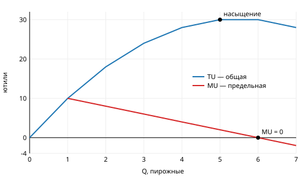
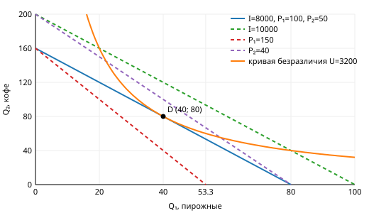
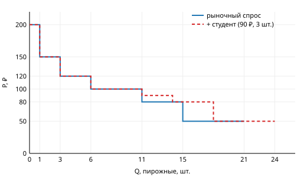

# Кейс «Кто съел все пирожные? История одного студента»

**Задание:** [задание.docx](задание.docx). Студент тратит стипендию 8000 ₽ на пирожные
(P₁ = 100 ₽) и кофе (P₂ = 50 ₽) и хочет получить максимум полезности. Группа из 5 человек.
Шпаргалка — [SUMMARY.md](SUMMARY.md). Все числа пересчитывает [check.py](check.py)
(`python3 check.py` после `direnv allow` в корне репозитория; запасной вариант —
`nix develop -c python3 check.py`). PDF для сдачи — [solution.pdf](solution.pdf), собирается `make` в этой папке.

| Роль | Этап | Что делает |
| --- | --- | --- |
| Психолог | 1, 3б | потребности по Маслоу, эффекты спроса, пример Гиффена |
| Аналитик | 2 | TU и MU, насыщение |
| Экономист | 3, 3б | бюджетная линия, эффекты дохода и замещения |
| Студент-потребитель | 3, 4 | выбор набора D, рыночный спрос |
| Советник | итог | рекомендации |

---

## Этап 1. Пирамида желаний (Психолог)

*Условие: разложить потребности по Маслоу и найти у себя эффекты потребительского поведения.*

| Уровень | Пример |
| --- | --- |
| физиологические | поесть между парами, выспаться |
| безопасность | отложить деньги до конца месяца, не потерять стипендию |
| принадлежность | кафе с одногруппниками |
| признание | сессия на «отлично», доклад на конференции |
| самореализация | свой проект, хакатон |

| Эффект | Пример |
| --- | --- |
| присоединения | все берут раф, и я беру |
| сноба | не пью кофе из автомата, «его пьют все» |
| Веблена | кофе подороже ради логотипа на стакане |
| предположительного качества | «за 150 ₽ точно вкуснее, чем за 100 ₽» |
| нерациональный спрос | третье пирожное «за компанию» |
| спекулятивный | талоны на обед впрок перед подорожанием |

**Вывод: рациональному выбору мешают эффекты присоединения, сноба и Веблена**, потому что в них
полезность зависит от поведения других, а не от самого блага. Нерациональный спрос нарушает
условие оптимума: покупку просто никто не считает.

---

## Этап 2. Полезность пирожного (Аналитик)

*Условие: по TU найти MU, построить графики, найти насыщение.*

**Формула: MU = ΔTU / ΔQ** (ΔQ = 1, то есть MU — разность соседних TU).

| Q | 1 | 2 | 3 | 4 | 5 | 6 | 7 |
| --- | --- | --- | --- | --- | --- | --- | --- |
| TU | 10 | 18 | 24 | 28 | 30 | 30 | 28 |
| **MU** | **10** | **8** | **6** | **4** | **2** | **0** | **−2** |

- **Насыщение — на 5–6-м пирожном:** TU = 30 (максимум), MU₆ = 0.
- **Закон убывающей предельной полезности:** каждая следующая единица блага даёт меньше
  полезности, чем предыдущая.
- **MU₇ = −2:** после насыщения пирожное вредит (переедание), и TU падает с 30 до 28.
- Проверка: ΣMU = 28 = TU₇ ✓.

---

## Этап 3. Бюджет под контролем (Экономист, Студент-потребитель)

*Условие: I = 8000 ₽, P₁ = 100 ₽, P₂ = 50 ₽. Построить бюджетную линию, её сдвиги и оптимум D.*

**Формула: P₁Q₁ + P₂Q₂ = I** → Q₂ = I/P₂ − (P₁/P₂)·Q₁. Точки на осях: I/P₁ и I/P₂.
Наклон −P₁/P₂ — это относительная цена.

| Ситуация | Пирожные max (I/P₁) | Кофе max (I/P₂) | Наклон | Следствие |
| --- | --- | --- | --- | --- |
| исходная | 80 | 160 | −2 | 1 пирожное = 2 кофе |
| I = 10 000 ₽ | 100 | 200 | −2 | **параллельный сдвиг вправо**, доступно больше всего |
| P₁ = 150 ₽ | 53,3 | 160 | −3 | **поворот внутрь** вокруг (0; 160), пирожные дороже относительно кофе |
| P₂ = 40 ₽ | 80 | 200 | −2,5 | **поворот наружу** вокруг (80; 0), кофе дешевле |

**Доступно** всё, что на линии и под ней (100Q₁ + 50Q₂ ≤ 8000). Например, (20; 100) стоит
7000 ₽ и доступен, а (60; 60) стоит 9000 ₽ и недоступен.

**Оптимум D.** Функции полезности в задании нет, поэтому берём простейшую: **U = Q₁·Q₂**.
Для неё MU₁ = Q₂, MU₂ = Q₁, и на каждое благо уходит половина дохода:

> **D: Q₁ = 8000 / (2·100) = 40 пирожных, Q₂ = 8000 / (2·50) = 80 кофе.**
> Проверка: 100·40 + 50·80 = 8000 ✓; MU₁/P₁ = 80/100 = 0,8 = MU₂/P₂ = 40/50 ✓.

В точке D кривая безразличия касается бюджетной линии: MRS = MU₁/MU₂ = P₁/P₂ = 2.

**Смысл MU₁/P₁ = MU₂/P₂:** последний рубль даёт одинаковую полезность и в пирожных, и в кофе.
Если бы в кофе он давал больше, выгодно было бы перекинуть рубль туда. Перекидывать нечего →
полезность максимальна.

---

## Этап 3б. Эффекты дохода и замещения (Экономист, Психолог)

*Условие: пирожные подорожали со 100 до 150 ₽.*

**Метод Слуцкого:** даём студенту столько денег, чтобы старый набор был ему по карману при новых
ценах. Разница между старым и компенсированным набором — эффект замещения, остаток — эффект дохода.

| Набор | Доход, ₽ | Пирожные | Кофе |
| --- | --- | --- | --- |
| A — было (P₁ = 100) | 8000 | 40 | 80 |
| C — компенсированный | 150·40 + 50·80 = 10 000 | 10 000/300 = 33,3 | 10 000/100 = 100 |
| B — стало (P₁ = 150) | 8000 | 8000/300 = 26,7 | 8000/100 = 80 |

| Эффект | Пирожные | Кофе |
| --- | --- | --- |
| замещения (A → C) | −6,7 | +20 |
| дохода (C → B) | −6,7 | −20 |
| **итого** | **−13,3** | **0** |

1. **Реальный доход падает на 20 %:** номинально 8000 ₽, но старый набор теперь стоит
   10 000 ₽ (8000/10 000 = 0,8).
2. **Эффект дохода:** студент «обеднел» → покупает меньше обоих благ.
3. **Эффект замещения:** пирожное стоит уже 3 кофе, а не 2 → пирожные заменяются кофе.
4. **Выбор: меньше пирожных (40 → 26,7), кофе столько же.** У пирожных оба эффекта тянут вниз,
   у кофе гасят друг друга. Проверка: 150·26,7 + 50·80 = 8000 ✓.
5. **Закон Энгеля:** подорожание равносильно снижению дохода, а чем ниже доход, тем больше
   его доля уходит на еду. Будь у студента траты кроме еды (кафе, кино), они бы сократились
   первыми. У нас вся стипендия уходит на еду, поэтому доля пирожных остаётся 50 %.
6. **Эффект Гиффена:** 1600 ₽ на 20 приёмов пищи, доширак стоит 50 ₽, котлета 150 ₽.
   x + y = 20, 50x + 150y = 1600 → **14 доширака и 6 котлет**. Доширак подорожал до 60 ₽:
   60x + 150(20 − x) = 1600 → **15,6 доширака и 4,4 котлеты**. Цена выросла, а доширака
   покупают больше: эффект дохода сильнее замещения, доширак — товар Гиффена.

---

## Этап 4. Рыночный спрос (Студент-потребитель)

*Условие: шесть студентов, у каждого своя цена спроса (максимум, который он готов заплатить)
и объём. Построить рыночный спрос.*

**Формула: Qᵈ(P) = Σ qᵢ по всем, у кого Pᵢ ≥ P** — сложение индивидуальных кривых по
горизонтали. Индивидуальная кривая — «ступенька»: при P ≤ Pᵢ студент берёт qᵢ, при P > Pᵢ не берёт ничего.

| Цена, ₽ | Кто покупает | Qᵈ, шт. | + новый (90 ₽, 3 шт.) |
| --- | --- | --- | --- |
| 50 | Аня 6, Борис 4, Вера 5, Гриша 3, Дина 2, Елена 1 | **21** | 24 |
| 80 | все, кроме Ани | **15** | 18 |
| 90 | Вера, Гриша, Дина, Елена | 11 | 14 |
| 100 | Вера, Гриша, Дина, Елена | **11** | 11 |
| 120 | Гриша, Дина, Елена | **6** | 6 |
| 150 | Дина, Елена | **3** | 3 |
| 200 | Елена | **1** | 1 |

- **Максимальный спрос — при 50 ₽** (21 шт.): покупают все.
- **Один покупатель (Елена) остаётся при 151–200 ₽.** Выше 200 ₽ спрос равен нулю.
- **Закон спроса:** цена ↑ → уходят покупатели с низкой ценой спроса → Qᵈ ↓
  (21 → 15 → 11 → 6 → 3 → 1).
- **Новый студент:** при P ≤ 90 спрос растёт на 3 шт., выше 90 ₽ ничего не меняется.
  Кривая **сдвигается вправо в нижней части**, и появляется ступенька на 90 ₽. Это **изменение
  спроса** (неценовой фактор — число покупателей), а не движение вдоль кривой.

---

## Рекомендации (Советник)

1. **Не больше 5 пирожных подряд:** с 6-го MU ≤ 0, деньги уходят впустую.
2. **Делить бюджет так, чтобы MU/P были равны:** при текущих ценах это 40 пирожных и 80 кофе.
3. **Пирожные подорожали — сократить пирожные, кофе не трогать:** брать 26 пирожных (26,7 не купишь) и 80 кофе,
   выйдет 7900 ₽ ≤ 8000 ₽.
4. **Стипендия выросла или кофе подешевело:** бюджетная линия уходит наружу, реальный доход растёт.
5. **Не поддаваться присоединению и Веблену:** «как у всех» и «дорого, значит круто»
   полезности не добавляют, а бюджет съедают.
