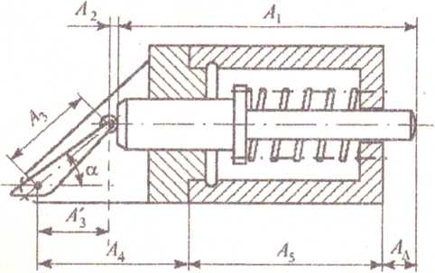

# Задание

Решить прямую задачу (синтез точности) размерной цепи механизма толкателя,
изображённого на рисунке, методами максимума-минимума и теоретико-вероятностным.
Способ решения стандартный. Дать ответы на контрольные вопросы.

{width=75%}

Исходные данные (вариант 1):

| Звено | Номинал, мм | Закон распределения | λ'² |
| :---: | :---: | --- | :---: |
| A₁ | 150 | треугольника (Симпсона) | 1/6 |
| A₂ | 20 | треугольника (Симпсона) | 1/6 |
| A₃ | 100 | нормальный (Гаусса) | 1/9 |
| A₄ | 100 | нормальный (Гаусса) | 1/9 |
| A₅ | 120 | равновероятный | 1/3 |

Угол α = 30°; замыкающее звено $A_\Delta^{\text{+0,1}}$; процент риска P = 4,5 %.

# Решение

## 1. Замыкающее звено и уравнение размерной цепи

Замыкающее звено A~Δ~ — выступание конца толкателя за правый торец корпуса.
Размерный контур строим от оси шарнира рычага: по проекции рычага A₃′ = A₃·cos α,
размеру A₂ от оси ролика до торца толкателя и длине толкателя A₁ доходим до конца толкателя; по размерам
корпуса A₄ и A₅ — до правого торца корпуса.

Уравнение размерной цепи:

$$A_\Delta = A_1 + A_2 + A_3\cos\alpha - A_4 - A_5.$$

Увеличивающие звенья: A₁, A₂ (ξ = +1) и A₃ (ξ₃ = cos 30° = 0,866); уменьшающие: A₄, A₅ (ξ = −1).

Номинальный размер замыкающего звена по формуле (3.1):

A~Δ~ = 150 + 20 + 100·0,866 − 100 − 120 = 36,603 мм.

Параметры замыкающего звена: Δ~ВΔ~ = +0,1 мм; Δ~НΔ~ = 0;\
T~Δ~ = 0,1 мм; Δ~0Δ~ = 0,5(0,1 + 0) = +0,05 мм.

Координаты середин полей допусков составляющих звеньев назначаем по общему правилу:
A₁ (толкатель) — охватываемый размер, Δ~01~ = −T₁/2; A₂, A₃, A₄ — прочие размеры,
Δ~0j~ = 0; координату последнего звена A₅ вычисляем по формуле (3.2).

## 2. Метод максимума-минимума

Среднее значение допуска по формуле (3.18):

$$T_{ср} = \frac{T_\Delta}{\sum|\xi_j|} = \frac{0{,}1}{1 + 1 + 0{,}866 + 1 + 1} = \frac{0{,}1}{4{,}866} = 0{,}0206 \text{ мм.}$$

С учётом размеров звеньев и сложности их получения назначаем допуски (ряды по ГОСТ 6636-69):
T₁ = 0,025 мм (самый длинный размер); T₂ = 0,016 мм; T₃ = 0,020 мм; T₄ = 0,020 мм.

Допуск последнего звена из уравнения (3.6):

T₅ = 0,1 − (0,025 + 0,016 + 0,866·0,020 + 0,020) = 0,0217 мм, принимаем T₅ = 0,021 мм.

Проверка по формуле (3.6):

T~Δ~ = 0,025 + 0,016 + 0,866·0,020 + 0,020 + 0,021 = 0,0993 мм ≤ 0,1 мм. Допуски назначены верно.

Координаты середин полей допусков: Δ~01~ = −0,0125 мм; Δ~02~ = Δ~03~ = Δ~04~ = 0.

Из уравнения (3.2): Δ~0Δ~ = Δ~01~ + Δ~02~ + ξ₃Δ~03~ − Δ~04~ − Δ~05~;

0,05 = −0,0125 + 0 + 0 − 0 − Δ~05~, откуда Δ~05~ = −0,0625 мм.

Предельные отклонения по формулам (3.16), мм:

| Звено | T | Δ~0~ | Δ~В~ | Δ~Н~ | Запись |
| :---: | :---: | :---: | :---: | :---: | :---: |
| A₁ | 0,025 | −0,0125 | 0 | −0,025 | $150_{\text{−0,025}}$ |
| A₂ | 0,016 | 0 | +0,008 | −0,008 | 20 ± 0,008 |
| A₃ | 0,020 | 0 | +0,010 | −0,010 | 100 ± 0,010 |
| A₄ | 0,020 | 0 | +0,010 | −0,010 | 100 ± 0,010 |
| A₅ | 0,021 | −0,0625 | −0,052 | −0,073 | $120^{\text{−0,052}}_{\text{−0,073}}$ |

Проверка:

Δ~ВΔ~ = Δ~В1~ + Δ~В2~ + ξ₃Δ~В3~ − Δ~Н4~ − Δ~Н5~ = 0 + 0,008 + 0,866·0,010 + 0,010 + 0,073 = +0,0997 мм;

Δ~НΔ~ = Δ~Н1~ + Δ~Н2~ + ξ₃Δ~Н3~ − Δ~В4~ − Δ~В5~ = −0,025 − 0,008 − 0,0087 − 0,010 + 0,052 = +0,0003 мм.

Отклонения замыкающего звена лежат внутри заданных 0…+0,1 мм. Задача решена верно.

## 3. Теоретико-вероятностный метод

Процент риска P = 4,5 %, по табл. 3.1 коэффициент риска t~Δ~ = 2,0.

$$\sum \xi_j^2{\lambda'_j}^2 = \frac{1}{6} + \frac{1}{6} + 0{,}866^2\cdot\frac{1}{9} + \frac{1}{9} + \frac{1}{3} = 0{,}861.$$

Среднее значение допуска по формуле (3.19):

$$T_{ср} = \frac{T_\Delta}{t_\Delta\sqrt{\sum \xi_j^2{\lambda'_j}^2}} = \frac{0{,}1}{2{,}0\cdot\sqrt{0{,}861}} = \frac{0{,}1}{1{,}856} = 0{,}0539 \text{ мм.}$$

Назначаем допуски: T₁ = 0,06 мм; T₂ = 0,04 мм; T₃ = 0,05 мм; T₄ = 0,05 мм.

Допуск звена A₅ находим из формулы (3.15):

$$\frac{0{,}06^2}{6} + \frac{0{,}04^2}{6} + \frac{0{,}866^2\cdot 0{,}05^2}{9} + \frac{0{,}05^2}{9} = 0{,}001353 \text{ мм}^2,$$

$$T_5 = \sqrt{3\left[\left(\frac{T_\Delta}{t_\Delta}\right)^2 - 0{,}001353\right]} = \sqrt{3\,(0{,}0025 - 0{,}001353)} = 0{,}0587 \text{ мм,}$$

принимаем T₅ = 0,056 мм.

Проверка по формуле (3.15):

$$T_\Delta = 2{,}0\sqrt{0{,}001353 + \frac{0{,}056^2}{3}} = 2{,}0\cdot 0{,}04897 = 0{,}0979 \text{ мм} \le 0{,}1 \text{ мм,}$$

расхождение 2,1 %. Допуски назначены правильно.

Координаты середин полей допусков: Δ~01~ = −0,03 мм; Δ~02~ = Δ~03~ = Δ~04~ = 0;\
из уравнения (3.2): 0,05 = −0,03 − Δ~05~, Δ~05~ = −0,08 мм.

| Звено | T | Δ~0~ | Δ~В~ | Δ~Н~ | Запись |
| :---: | :---: | :---: | :---: | :---: | :---: |
| A₁ | 0,06 | −0,03 | 0 | −0,06 | $150_{\text{−0,06}}$ |
| A₂ | 0,04 | 0 | +0,02 | −0,02 | 20 ± 0,02 |
| A₃ | 0,05 | 0 | +0,025 | −0,025 | 100 ± 0,025 |
| A₄ | 0,05 | 0 | +0,025 | −0,025 | 100 ± 0,025 |
| A₅ | 0,056 | −0,08 | −0,052 | −0,108 | $120^{\text{−0,052}}_{\text{−0,108}}$ |

Проверка: Δ~0Δ~ = −0,03 − (−0,08) = +0,05 мм; с риском 4,5 % замыкающее звено
находится в пределах 0,05 ± 0,5·0,0979, то есть от +0,001 до +0,099 мм. Задача решена правильно.

## 4. Сравнение методов

| Звено | Максимум-минимум, мм | Теоретико-вероятностный, мм |
| :---: | :---: | :---: |
| A₁ | 0,025 | 0,06 |
| A₂ | 0,016 | 0,04 |
| A₃ | 0,020 | 0,05 |
| A₄ | 0,020 | 0,05 |
| A₅ | 0,021 | 0,056 |

При теоретико-вероятностном методе допуски составляющих звеньев получились в 2,4–2,7 раза
шире при допустимом риске 4,5 %.

Замыкающее звено во всех случаях: $A_\Delta = 36{,}603^{\text{+0,1}}$ мм.

# Ответы на контрольные вопросы

**1. Почему одна из координат середин полей допусков составляющих звеньев в обязательном
порядке должна рассчитываться?** Координаты середин связаны уравнением (3.2): координата
середины поля замыкающего звена равна алгебраической сумме координат середин составляющих
звеньев. Если назначить все координаты произвольно, равенство в общем случае не выполнится
и поле замыкающего звена сместится относительно заданного. Поэтому все координаты, кроме
одной, назначают из конструктивных соображений, а последнюю вычисляют из уравнения (3.2).

**2. Почему при решении прямой задачи допуски, полученные теоретико-вероятностным способом,
шире, чем при способе максимума-минимума?** Метод максимума-минимума рассчитан на худший
случай, когда все звенья одновременно выполнены по предельным размерам в неблагоприятную
сторону, поэтому допуски складываются арифметически. На практике отклонения звеньев
случайны и независимы, и сочетание крайних значений встречается редко. Теоретико-вероятностный
метод складывает допуски квадратично с учётом законов распределения и допускает небольшой
процент риска, поэтому при том же допуске замыкающего звена каждому звену можно дать
больший допуск. В нашем расчёте допуски выросли примерно в 2,5 раза.

**3. Что характеризует и от чего зависит коэффициент риска t~Δ~?** Коэффициент риска
показывает, сколько средних квадратических отклонений σ замыкающего звена укладывается
в половине его допуска: t~Δ~ = x/σ, где x = T~Δ~/2. Он зависит от принятого процента риска P, то есть от доли изделий, у которых
замыкающее звено может выйти за пределы допуска: чем меньше риск, тем больше t~Δ~
(P = 0,27 % — t~Δ~ = 3; P = 4,5 % — t~Δ~ = 2,0; P = 32 % — t~Δ~ = 1,0).

**4. Что характеризует и от чего зависит коэффициент относительного рассеяния λ'~j~?**
Он характеризует закон распределения отклонений звена и связывает среднее квадратическое
отклонение с полем рассеяния: λ'~j~ = 2σ~j~/ω~j~. Зависит от закона распределения, который
определяется технологией получения размера: для нормального закона λ'² = 1/9, для закона
треугольника (Симпсона) 1/6, для равновероятного закона или при отсутствии сведений о законе 1/3.

**5. Почему метод называется стандартным, какие у него достоинства и недостатки?**
Методика решения прямой задачи этим способом установлена стандартом ГОСТ 16320-80
(РД 50-635-87), отсюда название. Достоинства: универсальность — подходит и для метода
максимума-минимума, и для теоретико-вероятностного, позволяет учесть разную сложность
изготовления звеньев, а результат легко проверить решением обратной задачи. Недостаток —
решение неоднозначно: допуски подбирают по среднему значению, и результат зависит от опыта
и решений конструктора.

# Нормативные документы

1. РД 50-635-87 Методические указания. Цепи размерные. Основные понятия. Методы расчёта линейных и угловых цепей.
2. ГОСТ 16319-80 Цепи размерные. Термины и определения.
3. ГОСТ 16320-80 Цепи размерные. Методы расчёта плоских цепей.
4. ГОСТ 6636-69 Нормальные линейные размеры.
